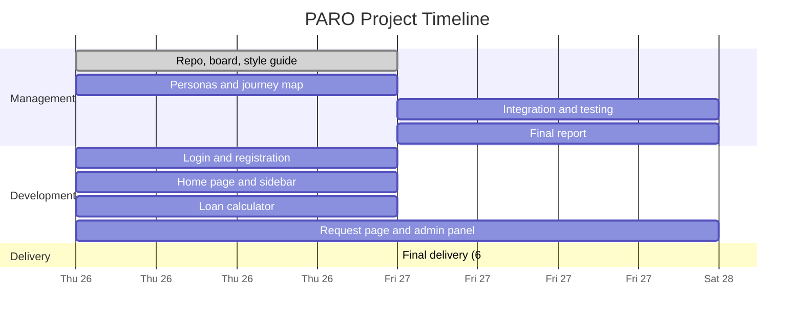

# PARO – Loan Calculator & Application System

PARO is a simple web application that lets users calculate a loan, submit a loan application, and lets administrators review and approve or reject those applications.

## Features

- Login and registration (new accounts are always regular users)
- Home page with sidebar navigation
- Loan calculator (monthly payment, total payment, total interest)
- Application form with loan summary
- Admin panel: list of applications with Approve / Reject actions

## Tech Stack

- HTML5, CSS3, JavaScript (vanilla)
- Bootstrap 5 (CDN)
- JSON for users and loan data, `localStorage` for new users and applications
- GitHub Pages for hosting

## Demo Accounts

| Role  | Username | Password |
|-------|----------|----------|
| Admin | admin    | admin123 |
| User  | user     | user123  |

## Project Structure

```
index.html        Login
register.html    Sign up
home.html        Presentation page + sidebar
calculator.html  Loan calculator
request.html     Application summary + applicant form
admin.html       Admin panel (admins only)
css/             Custom styles on top of Bootstrap
js/              Page logic
data/            users.json, loan-types.json
docs/            Style guide, personas, journey map, report
```

## Team

| Member    | Role                          | Main deliverable                          |
|-----------|-------------------------------|-------------------------------------------|
| Javier    | Project Leader                | Repo, board, docs, personas, journey map, report |
| Angel     | Authentication                | Login, registration, `auth.js`, users JSON |
| Emiliano  | Home & UI                     | Home page with sidebar, visual consistency |
| Alejandra | Calculator                    | Loan calculator page and logic            |
| Adrian    | Applications & Admin          | Request page and admin panel              |

## Timeline



## Workflow

1. Take your Issue from the board and move it to **In progress**.
2. Create your own branch: `feature/<page>-<name>` (e.g. `feature/calculator-alejandra`).
3. Work in small steps and **commit after each step** (research notes, first version, improved version).
4. Tick the checklist items in your Issue as you finish them.
5. Open a Pull Request to `main`. Javier reviews and merges.

Using AI is allowed. In every Pull Request add 2 lines: *what I researched / what AI helped with / what I changed*.

## Data Contract (everyone must follow this)

| Key / File | Where | Content |
|---|---|---|
| `data/users.json` | file | `{ "users": [ { "username", "password", "role", "name" } ] }` |
| `paro_users` | localStorage | New users created in registration (role always `"user"`) |
| `paro_session` | localStorage | `{ "username", "name", "role" }` of the logged-in user |
| `paro_draft` | sessionStorage | Loan chosen in calculator, read by `request.html` |
| `paro_requests` | localStorage | Array of applications (see below) |

Application object:

```json
{
  "id": 1732650000000,
  "date": "2026-11-26",
  "username": "user",
  "applicant": { "fullName": "", "email": "", "phone": "", "monthlyIncome": 0 },
  "loan": { "type": "Personal", "amount": 5000, "months": 24, "annualRate": 12,
            "monthlyPayment": 235.37, "totalPayment": 5648.88, "totalInterest": 648.88 },
  "status": "pending"
}
```

`status` is one of: `pending`, `approved`, `rejected`.

## Shared functions in `js/auth.js`

`getSession()`, `requireLogin()`, `requireAdmin()`, `logout()`. Include it in every protected page with `<script src="js/auth.js"></script>`.

## Documentation

- [Style Guide](docs/style-guide.md)
- [User Personas](docs/personas.md)
- [Journey Map](docs/journey-map.md)

## Running the project

`fetch` does not work when opening files directly. Use **GitHub Pages** (Settings → Pages → Branch `main`) or the VS Code *Live Server* extension.

## Known Limitations

- Passwords are stored in plain text in a public JSON file.
- New users and applications live in each browser's `localStorage`, so they are not shared between devices.
- A real system would require a backend and a database.
