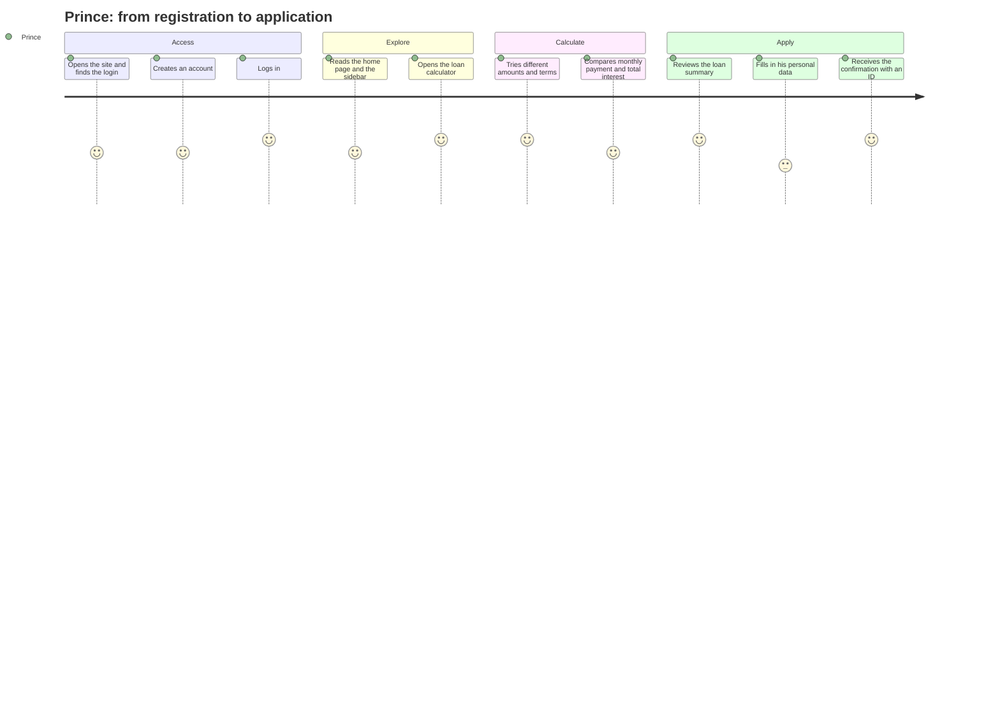
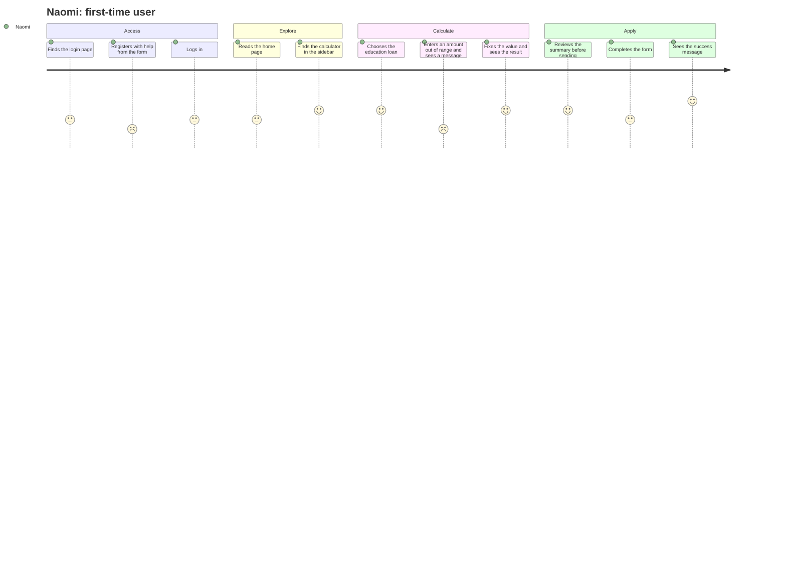
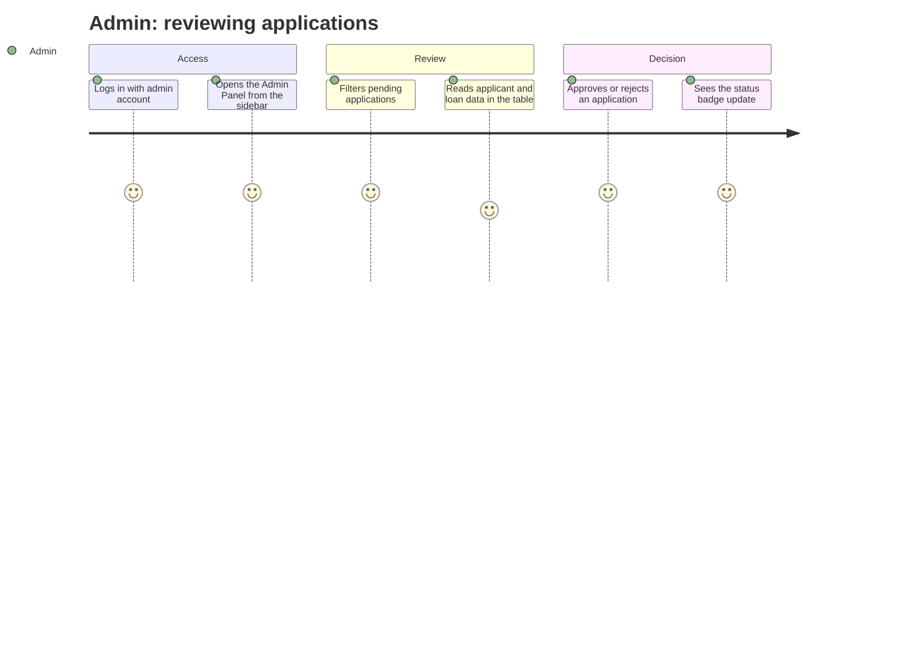
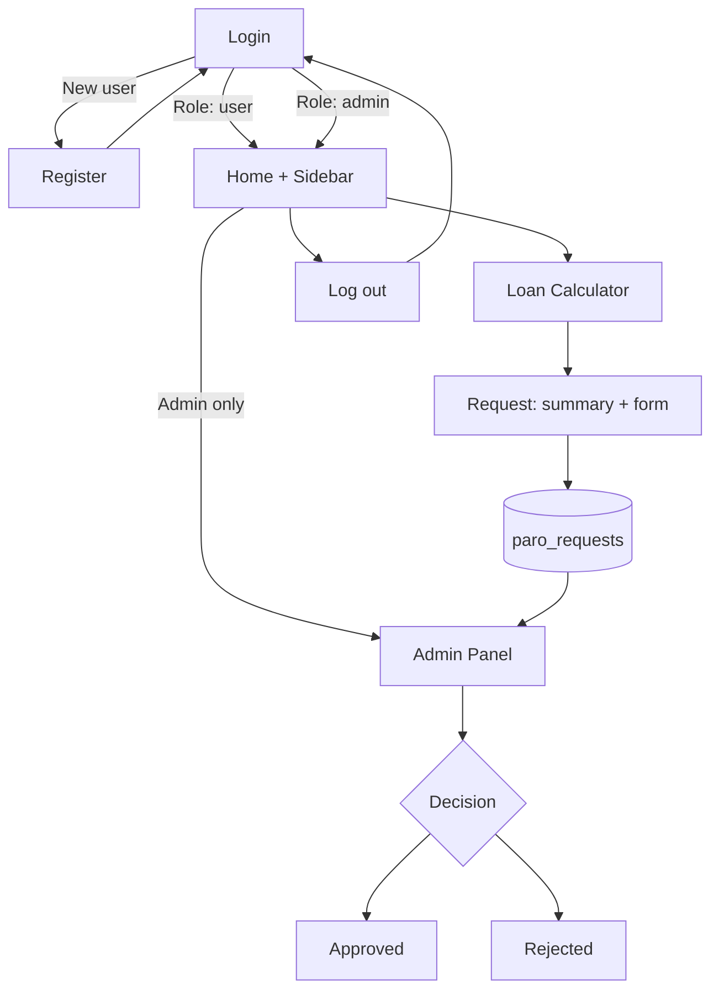

# Journey Map

> Scores go from 1 (frustrated) to 5 (satisfied). Fictional personas.

## Journey 1: Prince applies for a loan

## Journey 2: Naomi's first time

## Journey 3: Administrator reviews applications

## Flow chart of the system

## Pain points and opportunities

| Pain point | Persona | Solution in PARO |
|---|---|---|
| Out-of-range amounts confuse the user | Naomi | Clear validation messages in plain English |
| Filling in personal data feels long | Prince | Only 4 required fields |
| Not knowing the total cost | Prince | Result card with total payment and interest |
| Hard to tell pending from reviewed applications | Admin | Status badges and filter |
| Regular users reaching admin tools | Admin | `requireAdmin()` redirect |
