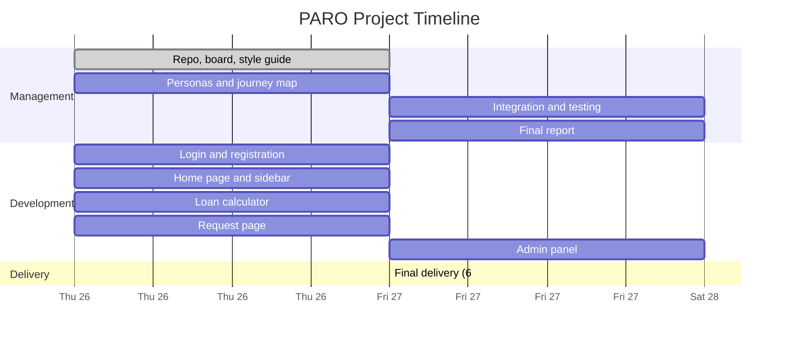
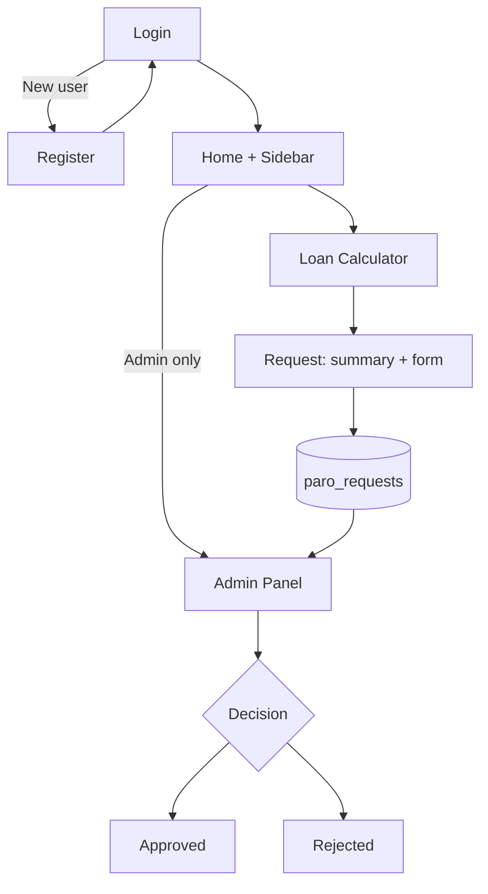

 # PARO – Project Report

**Loan Calculator & Application System**
Prepared by: Javier (Project Leader) and team
Date: November 27, 2026
Version: 1.0

---

## 1. Executive Summary

PARO is a web application that lets users calculate a loan, submit a loan application and lets administrators review and approve or reject those applications. The system was designed, built and documented by a five-person team in two days (Thursday to Friday), using Bootstrap 5, vanilla JavaScript and JSON files, and managed through GitHub. 

Evrything worked fine :)

## 2. Project Overview

| | |
|---|---|
| **Product** | PARO Loan Calculator & Application System |
| **Objective** | Simulate a basic professional web project: login, loan calculation, application and admin review |
| **Scope** | 6 pages (login, register, home, calculator, request, admin), JSON-based users and loan types |
| **Duration** | Thursday – Friday (delivery at 6:30 PM) |
| **Repository** | [TO FILL: GitHub link] |
| **Live demo** | [TO FILL: GitHub Pages link] |

### Key features
- Login and registration (new accounts are always regular users)
- Home page with sidebar navigation
- Loan calculator: monthly payment, total payment and total interest
- Application form with loan summary
- Admin panel with Approve / Reject actions and status filters

## 3. Team and Roles

| Member | Role | Deliverable |
|---|---|---|
| Javier | Project Leader & Admin Panel | Repo, board, docs, personas, journey map, admin panel, report |
| Angel | Authentication | Login, registration, `auth.js` |
| Emiliano | Home & UI | Home page with sidebar |
| Alejandra | Calculator | Loan calculator page and logic |
| Adrian | Applications | Request page (summary + applicant form) |

## 4. Project Management

### 4.1 Methodology
Work was organized with a GitHub Project board (To do / In progress / In review / Done), one Issue per deliverable with a checklist, and two milestones (Thursday and Friday).

### 4.2 Workflow
1. Each member took an Issue and moved it to **In progress**.
2. Each member worked on a personal branch (`feature/<page>-<name>`).
3. Small, frequent commits after each completed checklist item.
4. Pull Request to `main`, reviewed and merged by the Project Leader.

### 4.3 Timeline

### 4.4 Standards and decisions
- A shared **Style Guide** (navy `#1F3A5F`, light gray background, Inter font, Bootstrap 5 components only).
- A shared **Data Contract** defining every JSON file and storage key, so each page could be built independently.
- Code freeze on Friday at 2:00 PM; afterwards only bug fixes, integration testing and the report.

[TO FILL: any change to the plan during the project and why.]

## 5. User Research and Design

### 5.1 Personas
| Persona | Profile | Main need |
|---|---|---|
| Prince Nwaekwu | Confident applicant, 28, freelance designer | Fast, transparent calculation |
| Naomi Solorio | Cautious first-time user, 54, shop owner | Simple navigation and clear messages |
| [Admin name] | Loan reviewer, 41, loan officer | Review and decide applications quickly |

Full detail: [docs/personas.md](../personas.md)

### 5.2 Journey Map
Three journeys were mapped (Prince, Naomi and the administrator), with pain points and the solution adopted in PARO for each one.
Full detail: [docs/journey-map.md](../journey-map.md)

### 5.3 System flow

## 6. Technical Summary

| Component | Technology |
|---|---|
| Interface | HTML5, Bootstrap 5 (CDN) |
| Logic | Vanilla JavaScript |
| Users and loan types | `data/users.json`, `data/loan-types.json` |
| New users and applications | Browser `localStorage` / `sessionStorage` |
| Hosting | GitHub Pages |

**Loan types (fictional rates):** Personal 12%, Auto 9%, Education 6%.
**Monthly payment formula:** `M = P · r / (1 − (1 + r)^−n)`, where `r = annualRate / 12 / 100` and `n` = number of months.

## 7. Deliverables Status

| Deliverable | Owner | Status |
|---|---|---|
| Login and registration | Angel | OK |
| Home page and sidebar | Emiliano | In progress — first version saved; browser testing and PR pending || Loan calculator | Alejandra | [TO FILL] |
| Request page | Adrian | Waiting |
| Admin panel | Javier | OK |
| Style guide, personas, journey map | Javier | Done |
| GitHub Pages deployment | Javier | Ok |

## 8. Testing and Integration

Full flow tested on Friday: register → login → calculate → apply → admin approves or rejects.

| Test | Result |
|---|---|
| Admin login (`admin`) | OK |
| User registration and login | OK |
| Calculator values and validations | OK |
| Application saved with correct structure | OK |
| Regular user blocked from `admin.html` | OK |
| Approve / Reject updates status | OK |

[TO FILL: bugs found during integration and how they were fixed.]

## 9. Individual Contributions

> Paste each member's executive report below, keeping their headings.

### 9.1 Javier – Project Leader & Admin Panel

**Name and role**
Javier, Project Leader and developer of the Admin Panel.

**Objective**
Plan and coordinate a five-person team to deliver PARO, a loan calculator and application system, in two days. Build the admin panel, where administrators review and approve or reject loan applications.

**What I delivered**
- GitHub repository with folder structure, README, shared Data Contract and Style Guide.
- Project board (To do / In progress / In review / Done), six Issues with checklists, and Thursday and Friday milestones.
- Personas, journey maps and system flow chart (Mermaid diagrams rendered in GitHub).
- Admin panel: `admin.html` and `js/admin.js`, with a table of applications, status filters and Approve / Reject actions.
- GitHub Pages deployment and final project report.

**How I did it**
I defined the architecture first: a Data Contract with every JSON file and storage key, so each member could build a page independently. I assigned one main deliverable per member according to their strengths, set a branch-per-feature workflow with Pull Requests reviewed by me, and defined a merge order based on dependencies (authentication first). For the admin panel I used Bootstrap 5 and vanilla JavaScript, built it in incremental steps (layout, rendering, approve/reject, filters), and tested it with sample applications loaded into localStorage. User-entered text is escaped before being displayed, and missing applicant data shows "N/A" instead of breaking the table.

**Challenges and solutions**
- *Naming mismatch:* the loan data file was named differently from the contract (`loan-type.json` vs `loan-types.json`), and it was unclear whether the loan `type` field should store the name or the ID. I decided on the file name from the contract and the full loan name, and updated the contract.
- *Dependencies:* every page depends on the authentication file, so I prioritized its merge first.
- *Deployment:* GitHub Pages returned a 404 because `main` had no `index.html` until the first Pull Request was merged. I solved it by merging the authentication branch first and then the remaining pages.
- No bugs found in integration testing 

**Final status**
admin panel merged, all pages integrated and live link working

**Lessons learned**
A shared contract and a clear merge order prevent most integration problems. Small commits and Pull Requests make progress visible, and early deployment would have exposed the dependency issues sooner. [TO FILL: one more lesson from the final integration.]

### 9.2 Angel – Authentication

## Name and role
Angel – Authentication (login, registration and session management).

## Objective
Build the authentication layer of PARO so that users can log in, new users can register, and every other page can check who is logged in, following the team's Data Contract and style guide.

## What I delivered
- `index.html`: login form in a centered Bootstrap card with a link to registration.
- `register.html`: registration form (name, username, password).
- `js/auth.js`: login against `data/users.json` + `paro_users`, saves `paro_session` and redirects to `home.html`; wrong credentials show a Bootstrap alert. New users are always saved with role `"user"`.
- Shared functions for the team: `getSession()`, `requireLogin()`, `requireAdmin()` and `logout()`.
- Improved version: empty-field validation and duplicate-username check (case-insensitive, including demo accounts).

## How I did it (steps, tools, decisions)
I worked on the branch `feature/auth-angel` using the GitHub web editor, following the Issue checklist in order. I used GitHub Copilot Chat as a step-by-step guide and Claude to review and test each piece of code before committing. I made 6 commits and 2 pull requests (#8 and #9), both merged into `main`. Key decisions: plain vanilla JavaScript with no extra libraries, using only the template from `docs/style-guide.md`, storing only username, name and role in the session (never the password), and committing each checklist item separately.

## Challenges and solutions
- Code copied from the chat was sometimes cut off; I checked every file before committing.
- When replacing the registration block, one line (`const loginForm`) was accidentally deleted, which would have broken login; it was detected in review and fixed before merging.
- GitHub Pages was disabled (404) for most of the work, so testing was done in a local browser until the team enabled it.

## Final status
All 6 checklist items in Issue #1 are complete and merged into `main`. On GitHub Pages, logging in with the demo account correctly redirects to `home.html`. That page shows a 404 for now, until the home page is merged.

## Lessons learned
Small, separate commits make progress easy to follow and review. Reviewing code before committing catches errors early. Agreeing on shared names (IDs, storage keys, functions) is what lets each teammate work in parallel.

### 9.3 Emiliano – Home & UI
## Name and role

Emiliano — Home page and UI.

## Objective

My objective was to create the PARO home page with a responsive sidebar and a clear introduction to the loan application flow. The page needed to follow the team’s visual guide and connect to the existing authentication functions.

## What I delivered

I prepared a first complete version of `home.html`. It includes the PARO navigation bar, a responsive sidebar with links to Home, Loan Calculator, Apply, Admin Panel, and Log out, and a main area with a welcome message, a three-step explanation, and cards for Personal, Auto, and Education loans. The cards show the rates provided in the project instructions.

The page also reads the logged-in user’s name with `getSession()`. The Admin Panel link is shown only when the user’s role is `admin`, and the page redirects visitors who are not logged in.

## How I did it (steps, tools, decisions)

I reviewed the README, the team style guide, and the shared stylesheet. I used the GitHub web editor on the `feature/home-emiliano` branch. The page combines layout components from Bootstrap’s Dashboard, Sidebars, Navbars, and Album examples. I reused the team’s Bootstrap CDN, Inter font, `css/styles.css`, and `js/auth.js`, without adding another library or editing shared files.

## Challenges and solutions

The main challenge was understanding how to place the main content inside the existing page structure and how saving in the web editor differs from publishing a page. I replaced the initial draft with one complete HTML file and kept browser testing separate from editing.

## Final status

The first version is saved in the editor. Browser testing, the commit and push, and the Pull Request are still pending.

## Lessons learned

I learned how Bootstrap layout examples can be combined, how responsive navigation works, and how a page can use a shared session function to display role-based navigation. I also learned that saving HTML in the editor does not by itself confirm that the published site is updated.

### 9.4 Alejandra – Loan Calculator
## Objective

My objective was to develop a functional loan calculator for PARO, a web application that allows users to estimate loan payments and submit loan applications. The calculator needed to follow the team's style guide and data contract while using HTML, Bootstrap 5, and vanilla JavaScript.

## What I delivered

I developed two main files: `calculator.html` and `js/calculator.js`. The calculator allows users to select a loan type, enter an amount, and choose a repayment period. It automatically displays the monthly payment, total payment, and total interest.

I also implemented input validation and a request button that stores the selected loan in `sessionStorage` using the `paro_draft` key before redirecting the user to the request page.

## How I did it (steps, tools, decisions)

I first researched the fixed-payment loan amortization formula. The monthly payment is calculated using the principal, monthly interest rate, and repayment period.

I built the interface using Bootstrap components and the team's shared stylesheet. I used `fetch()` to retrieve loan types, interest rates, and minimum and maximum values from the JSON file.

JavaScript event listeners were implemented to update the results automatically whenever users modify their inputs.

I worked with Visual Studio Code, PowerShell, Git, and GitHub, using the branch `feature/calculator-alejandra`. I organized my development into four commits and tested each stage using a local Python HTTP server.

## Challenges and solutions

One initial challenge was configuring Git on Windows, including setting up my author identity. I also identified a difference between the JSON filename in the repository and the data contract. I temporarily used the existing filename without modifying shared files.

I tested invalid amounts, repayment periods, automatic calculations, and the stored loan object using browser developer tools.

## Final status

All five development tasks in Issue #3 have been implemented, and my changes have been pushed to GitHub. The calculator works independently, including validation and draft storage. Authentication integration, final filename confirmation, and end-to-end testing with the request page remain pending.

## Lessons learned

This project helped me understand Bootstrap layouts, JavaScript event handling, JSON data retrieval, browser storage, input validation, and collaborative development using Git branches, commits, and GitHub Issues.

### 9.5 Adrian – Applications
[PASTE REPORT]

## 10. Limitations

- Passwords are stored in plain text in a public JSON file.
- New users and applications live in each browser's `localStorage`, so they are not shared between devices.
- No real backend, database or email notifications.
- All data and rates are fictional.

## 11. Future Improvements

- Backend and database (users, applications, secure authentication with encrypted passwords).
- Application status visible to the applicant.
- Email notifications and downloadable loan summary (PDF).
- Credit scoring rules and loan amortization table.

## 12. Conclusion

[TO FILL: 4–5 sentences. Was the objective met? What did the team learn about managing a project with GitHub (branches, board, pull requests)? What would we do differently?]

## Appendix

- Repository structure and Data Contract: see `README.md`
- Style guide: `docs/style-guide.md`
- Personas: `docs/personas.md`
- Journey map: `docs/journey-map.md`
- Pull Requests and commit history: [TO FILL: link to the repo's Pull Requests tab]
