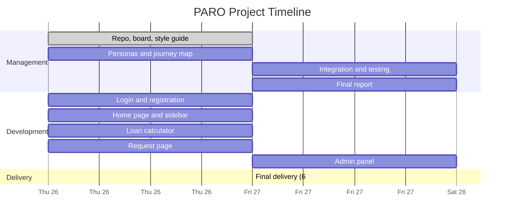
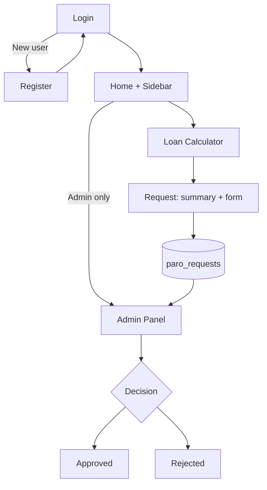

 # PARO – Project Report

**Loan Calculator & Application System**
Prepared by: Javier (Project Leader) and team
Date: November 27, 2026
Version: 1.0

---

## 1. Executive Summary

PARO is a web application that lets users calculate a loan, submit a loan application and lets administrators review and approve or reject those applications. The system was designed, built and documented by a five-person team in two days (Thursday to Friday), using Bootstrap 5, vanilla JavaScript and JSON files, and managed through GitHub.

[TO FILL: 3–4 sentences with the final result: what works, what was delivered on time, main lesson.]

## 2. Project Overview

| | |
|---|---|
| **Product** | PARO Loan Calculator & Application System |
| **Objective** | Simulate a basic professional web project: login, loan calculation, application and admin review |
| **Scope** | 6 pages (login, register, home, calculator, request, admin), JSON-based users and loan types |
| **Duration** | Thursday – Friday (delivery at 6:30 PM) |
| **Repository** | [TO FILL: GitHub link] |
| **Live demo** | [TO FILL: GitHub Pages link] |

### Key features
- Login and registration (new accounts are always regular users)
- Home page with sidebar navigation
- Loan calculator: monthly payment, total payment and total interest
- Application form with loan summary
- Admin panel with Approve / Reject actions and status filters

## 3. Team and Roles

| Member | Role | Deliverable |
|---|---|---|
| Javier | Project Leader & Admin Panel | Repo, board, docs, personas, journey map, admin panel, report |
| Angel | Authentication | Login, registration, `auth.js` |
| Emiliano | Home & UI | Home page with sidebar |
| Alejandra | Calculator | Loan calculator page and logic |
| Adrian | Applications | Request page (summary + applicant form) |

## 4. Project Management

### 4.1 Methodology
Work was organized with a GitHub Project board (To do / In progress / In review / Done), one Issue per deliverable with a checklist, and two milestones (Thursday and Friday).

### 4.2 Workflow
1. Each member took an Issue and moved it to **In progress**.
2. Each member worked on a personal branch (`feature/<page>-<name>`).
3. Small, frequent commits after each completed checklist item.
4. Pull Request to `main`, reviewed and merged by the Project Leader.

### 4.3 Timeline

### 4.4 Standards and decisions
- A shared **Style Guide** (navy `#1F3A5F`, light gray background, Inter font, Bootstrap 5 components only).
- A shared **Data Contract** defining every JSON file and storage key, so each page could be built independently.
- Code freeze on Friday at 2:00 PM; afterwards only bug fixes, integration testing and the report.

[TO FILL: any change to the plan during the project and why.]

## 5. User Research and Design

### 5.1 Personas
| Persona | Profile | Main need |
|---|---|---|
| Prince Nwaekwu | Confident applicant, 28, freelance designer | Fast, transparent calculation |
| Naomi Solorio | Cautious first-time user, 54, shop owner | Simple navigation and clear messages |
| [Admin name] | Loan reviewer, 41, loan officer | Review and decide applications quickly |

Full detail: [docs/personas.md](../personas.md)

### 5.2 Journey Map
Three journeys were mapped (Prince, Naomi and the administrator), with pain points and the solution adopted in PARO for each one.
Full detail: [docs/journey-map.md](../journey-map.md)

### 5.3 System flow

## 6. Technical Summary

| Component | Technology |
|---|---|
| Interface | HTML5, Bootstrap 5 (CDN) |
| Logic | Vanilla JavaScript |
| Users and loan types | `data/users.json`, `data/loan-types.json` |
| New users and applications | Browser `localStorage` / `sessionStorage` |
| Hosting | GitHub Pages |

**Loan types (fictional rates):** Personal 12%, Auto 9%, Education 6%.
**Monthly payment formula:** `M = P · r / (1 − (1 + r)^−n)`, where `r = annualRate / 12 / 100` and `n` = number of months.

## 7. Deliverables Status

| Deliverable | Owner | Status |
|---|---|---|
| Login and registration | Angel | [TO FILL] |
| Home page and sidebar | Emiliano | [TO FILL] |
| Loan calculator | Alejandra | [TO FILL] |
| Request page | Adrian | [TO FILL] |
| Admin panel | Javier | [TO FILL] |
| Style guide, personas, journey map | Javier | Done |
| GitHub Pages deployment | Javier | [TO FILL] |

## 8. Testing and Integration

Full flow tested on Friday: register → login → calculate → apply → admin approves or rejects.

| Test | Result |
|---|---|
| Admin login (`admin`) | [TO FILL] |
| User registration and login | [TO FILL] |
| Calculator values and validations | [TO FILL] |
| Application saved with correct structure | [TO FILL] |
| Regular user blocked from `admin.html` | [TO FILL] |
| Approve / Reject updates status | [TO FILL] |
| Mobile view | [TO FILL] |

[TO FILL: bugs found during integration and how they were fixed.]

## 9. Individual Contributions

> Paste each member's executive report below, keeping their headings.

### 9.1 Javier – Project Leader & Admin Panel
[PASTE REPORT]

### 9.2 Angel – Authentication
[PASTE REPORT]

### 9.3 Emiliano – Home & UI
[PASTE REPORT]

### 9.4 Alejandra – Loan Calculator
# PARO — Individual Executive Report

## Name and role

Alejandra Villegas — Loan Calculator Developer.

## Objective

My objective was to develop a functional loan calculator for PARO, a web application that allows users to estimate loan payments and submit loan applications. The calculator needed to follow the team's style guide and data contract while using HTML, Bootstrap 5, and vanilla JavaScript.

## What I delivered

I developed two main files: `calculator.html` and `js/calculator.js`. The calculator allows users to select a loan type, enter an amount, and choose a repayment period. It automatically displays the monthly payment, total payment, and total interest.

I also implemented input validation and a request button that stores the selected loan in `sessionStorage` using the `paro_draft` key before redirecting the user to the request page.

## How I did it (steps, tools, decisions)

I first researched the fixed-payment loan amortization formula. The monthly payment is calculated using the principal, monthly interest rate, and repayment period.

I built the interface using Bootstrap components and the team's shared stylesheet. I used `fetch()` to retrieve loan types, interest rates, and minimum and maximum values from the JSON file.

JavaScript event listeners were implemented to update the results automatically whenever users modify their inputs.

I worked with Visual Studio Code, PowerShell, Git, and GitHub, using the branch `feature/calculator-alejandra`. I organized my development into four commits and tested each stage using a local Python HTTP server.

## Challenges and solutions

One initial challenge was configuring Git on Windows, including setting up my author identity. I also identified a difference between the JSON filename in the repository and the data contract. I temporarily used the existing filename without modifying shared files.

I tested invalid amounts, repayment periods, automatic calculations, and the stored loan object using browser developer tools.

## Final status

All five development tasks in Issue #3 have been implemented, and my changes have been pushed to GitHub. The calculator works independently, including validation and draft storage. Authentication integration, final filename confirmation, and end-to-end testing with the request page remain pending.

## Lessons learned

This project helped me understand Bootstrap layouts, JavaScript event handling, JSON data retrieval, browser storage, input validation, and collaborative development using Git branches, commits, and GitHub Issues.

### 9.5 Adrian – Applications
[PASTE REPORT]

## 10. Limitations

- Passwords are stored in plain text in a public JSON file.
- New users and applications live in each browser's `localStorage`, so they are not shared between devices.
- No real backend, database or email notifications.
- All data and rates are fictional.

## 11. Future Improvements

- Backend and database (users, applications, secure authentication with encrypted passwords).
- Application status visible to the applicant.
- Email notifications and downloadable loan summary (PDF).
- Credit scoring rules and loan amortization table.

## 12. Conclusion

[TO FILL: 4–5 sentences. Was the objective met? What did the team learn about managing a project with GitHub (branches, board, pull requests)? What would we do differently?]

## Appendix

- Repository structure and Data Contract: see `README.md`
- Style guide: `docs/style-guide.md`
- Personas: `docs/personas.md`
- Journey map: `docs/journey-map.md`
- Pull Requests and commit history: [TO FILL: link to the repo's Pull Requests tab]
